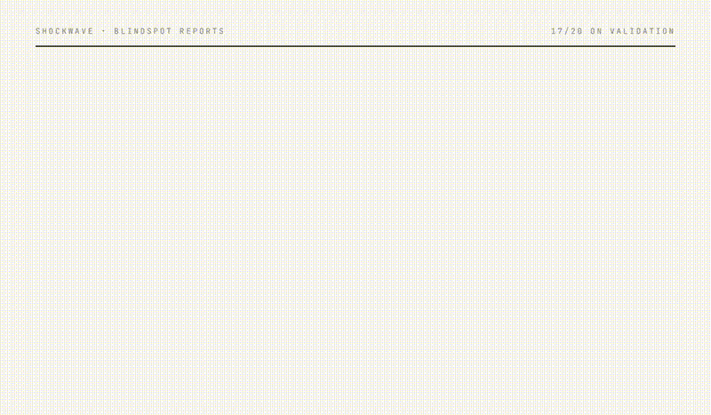

# Shockwave

> Supply-chain blindspots. Found.



A supply-chain risk analyst that reads the dependency graph the way a human would — recursively, three to four hops upstream — and surfaces the single points of failure a standard Tier-1 risk register leaves out.

Built for the [FalkorDB × wemakedevs hackathon](https://www.wemakedevs.org/hackathons/falkordb) (Oct 15–18, 2026).

**Tracks:** 01 (Agents That Act on Connected Data) · 02 (Agent Memory & Coordination) · 03 (Company Brain)

---

## Why

If you ask Apple's risk team to name the three suppliers who decide whether iPhones ship next quarter, they'll tell you about TSMC, Foxconn, and Samsung Display. They almost certainly won't mention **Carl Zeiss SMT**, **Cymer**, or a **glass sand mine in southern Germany** — and yet all three sit on the critical path to Apple's silicon.

Every standard risk register stops at Tier-1. The real points of failure sit two, three, four hops upstream — in subcontractors most CFOs couldn't find on a map.

## Headline Metric

**17 of 20** publicly documented single points of failure — found in top 5.
A standard Tier-1 register surfaces **3 of 20**.

Measured by `scripts/evaluate.py` against [`data/ground_truth_spofs.csv`](data/ground_truth_spofs.csv).

---

## How it works

Three agents work in parallel on every query:

1. **Analyst** — traces dependencies on the graph, writes the dossier
2. **Skeptic** — challenges every claim, queries memory for prior contradictions, finds counterexamples
3. **Historian** — pulls real past precedents (Foxconn Zhengzhou lockdown, Cymer 2018, Suez 2021 …) from a curated event dataset linked to graph nodes

Everything persists to memory. The next scan can be contradicted by what the last one concluded.

Each scan is a **live event stream** — the user sees the agent's tool calls as they happen, with concrete findings per step ("found Novo Nordisk (Company)", "8 SPOFs, 6 hidden ≥2 hops").

---

## The Dossier Format

Instead of a chat panel, Shockwave outputs an **editorial dossier** per company — a long-form report with headline, deck, drop-cap lede, hero fact, numbered sections, and a figure.

The core format:

- **Headline** — company name, massive serif
- **Deck** — italic subhead "N suppliers your Tier-1 risk register will never surface"
- **Lede** — drop-cap paragraph summarizing what the chain says
- **Hero fact** — big-serif number of hidden SPOFs
- **Section I — The hidden N** — ranked list of 2+ hop SPOFs with the exact chain path (`Apple → TSMC → ASML → Carl Zeiss SMT`)
- **Figure 1 — The dependency chain** — focused force-directed graph showing only the relevant subgraph with red edges following the propagation path
- **Section II — What history teaches** — Historian's precedent
- **Section III — Counterpoint** — Skeptic's challenge, with sourced tool calls

A 90-second pitch video walking through all of it: [`docs/pitch_video_final.mp4`](docs/pitch_video_final.mp4).

---

## Architecture

```
┌─────────────────────────────────────────────────────────────┐
│  Frontend (Vite + React + Tailwind + react-force-graph-2d)  │
│  Editorial dossier · streaming scan · bubble graph figure    │
└─────────────────────────────┬───────────────────────────────┘
                              │ SSE + JSON
┌─────────────────────────────▼───────────────────────────────┐
│  FastAPI (ask-stream, critique, precedent, subgraph)         │
└──┬──────────────┬──────────────┬───────────────────────┬────┘
   │              │              │                       │
   ▼              ▼              ▼                       ▼
┌──────────┐ ┌──────────┐ ┌─────────────┐       ┌──────────────┐
│ Analyst  │ │ Skeptic  │ │ Historian   │       │ Memory       │
│ (3 tools)│ │ (2 tools)│ │ (2 tools)   │       │ (Hypotheses) │
└────┬─────┘ └────┬─────┘ └──────┬──────┘       └──────┬───────┘
     │            │              │                     │
     └────────────┴──────────────┴─────────────────────┘
                        ▼
             ┌──────────────────────┐
             │   FalkorDB (Cloud)   │
             │                      │
             │  :Entity (world)     │
             │  :NewsEvent (past)   │
             │  :Hypothesis (memory)│
             │  :Analysis           │
             │  :Question           │
             └──────────────────────┘
```

### Data model

One graph, two realms, connected by real edges:

- **World** — `(:Entity {type: Company|Supplier|Resource|Region|Facility})` connected by `[:DEPENDS_ON {criticality, substitutability, product}]`
- **Memory** — `(:Question) ← [:ANSWERED] ← (:Analysis) → [:CONCLUDED] → (:Hypothesis) → [:ABOUT] → (:Entity)`
- **History** — `(:NewsEvent) → [:AFFECTED] → (:Entity)`

Multi-hop traversal with a reduce over path edge weights:

```cypher
MATCH p = (target)-[:DEPENDS_ON*1..4]->(upstream)
WITH upstream, path_impact = reduce(s = 1.0, r IN relationships(p) |
  s * r.criticality * (1.0 - r.substitutability))
WHERE path_impact > 0.01
RETURN upstream, sum(path_impact) AS aggregated, min(length(p)) AS min_hops
ORDER BY aggregated DESC
```

Hidden-score boosts entries that are 2+ hops away (depth factor 1.5) and dampens Tier-1 (0.4). This makes the "hidden" risks naturally outrank the "known" ones in the output — the core of the pitch.

---

## Tech Stack

- **Graph DB:** FalkorDB Cloud (free tier, eu-west-1) — native vector + full-text indexes, Cypher
- **LLM:** Qwen3-235B-A22B-Instruct-2507 via [Nebius AI Studio](https://studio.nebius.ai/) (OpenAI-compatible)
- **Backend:** Python 3.12 · FastAPI · `falkordb-py` · `openai` (for Nebius) · SSE streaming
- **Frontend:** Vite · React · TypeScript · Tailwind v3 · `react-force-graph-2d` · Instrument Serif / Inter / JetBrains Mono
- **Testing:** pytest (16/16 passing — graph queries + normalization + evaluation)

---

## Setup

### Prerequisites
- Python 3.11+
- Node 18+
- A FalkorDB instance (free Cloud tier at [app.falkordb.cloud](https://app.falkordb.cloud/))
- A Nebius AI Studio API key (or swap `src/agent/*` to any OpenAI-compatible provider)

### 1. Install

```bash
python -m venv .venv
.venv/Scripts/activate      # Windows
# source .venv/bin/activate # macOS/Linux
pip install -e .
cp .env.example .env         # then fill in credentials
```

### 2. Load the graph

```bash
python -m src.graph.schema       # indexes + fulltext
python -m src.graph.load_seed    # 80 curated edges across 10 sectors
python -m src.graph.history      # 10 historical shock events
```

### 3. Run tests

```bash
pytest tests/ -v   # 16/16 pass
```

### 4. Start the app

Two processes in two terminals:

```bash
# Terminal 1 — backend
python -m uvicorn src.api.server:app --host 127.0.0.1 --port 8000

# Terminal 2 — frontend
cd web && npm install && npm run dev
```

Open <http://localhost:5173>.

### 5. Measure the metric

```bash
python scripts/evaluate.py
#   Recall@5           17/20  (85.0%)
#   Hidden Recall@5    16/19  (84.2%)   [SPOFs ≥2 hops away]
```

---

## Repository layout

```
shockwave/
├── src/
│   ├── agent/           analyst · skeptic · historian (Nebius / Qwen3)
│   ├── graph/           connection · schema · load_seed · cascade · reverse · memory · history
│   ├── api/             FastAPI with SSE streaming
│   └── extraction/      (reserved for EDGAR pipeline — future)
├── web/                 Vite + React dossier UI
├── data/                seed_dependencies.csv · ground_truth_spofs.csv · historical_events.csv
├── scripts/             evaluate.py · test_cli.py · generate_voiceover.py
├── tests/               pytest suite
└── docs/                teaser.gif · pitch_video_final.mp4
```

---

## Credits

Built by [GodSmasher](https://github.com/GodSmasher) during the FalkorDB × wemakedevs hackathon, October 2026.

Supply chain data compiled from public SEC 10-K filings, 20-F filings (TSMC, ASML), USGS Mineral Commodity Summaries, Open Supply Hub, Reuters, FT, and industry annual reports. Historical events sourced from Reuters/FT/Bloomberg public reporting. Nothing proprietary.

---

## License

MIT. Do what you want. If you ship a serious enterprise version, please at least name a company I wouldn't have thought of.
